# Evidencias de sistema · Aplicación

Este repositorio guarda solo las evidencias. El código está en dos repositorios de la
organización `agecare-capstone`, porque la app y el backend se compilan y despliegan por separado.

| Entregable | Enlace |
|---|---|
| Código de la app (Flutter) | [github.com/agecare-capstone/CapstoneAgecare](https://github.com/agecare-capstone/CapstoneAgecare) |
| Código del backend (FastAPI) | [github.com/agecare-capstone/agecare-backend](https://github.com/agecare-capstone/agecare-backend) |
| Versión web (MVP) | https://agecare-tan.vercel.app |
| Backend en Azure (documentación interactiva) | https://agecare-api-xnjbc.azurewebsites.net/docs |
| APK Android | Sección [Releases](https://github.com/agecare-capstone/CapstoneAgecare/releases) del repositorio de la app |

Cuentas de demostración: `demo@agecare.app` (familiar), `cuidadora@agecare.app`, `medico@agecare.app` y `elena@agecare.app` (adulto mayor).

## Capturas

Versión web en modo demostración (datos de ejemplo), vista de celular, cuenta familiar.

| # | Pantalla | Captura |
|---|---|---|
| 1 | Inicio de sesión | [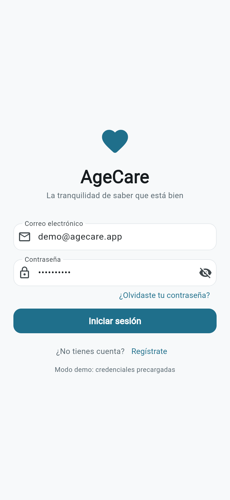](capturas/01-login.png) |
| 2 | Inicio del familiar: semáforo de bienestar, resumen del día y accesos rápidos | [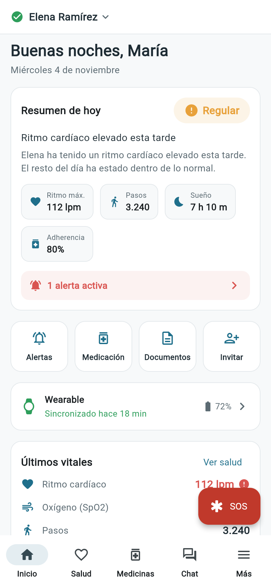](capturas/02-inicio.png) |
| 3 | Dashboard de salud con los últimos signos vitales del reloj | [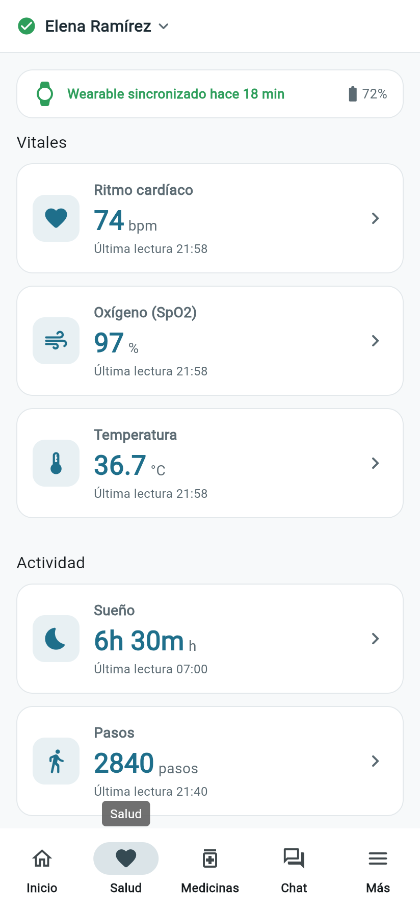](capturas/03-salud.png) |
| 4 | Tendencia de ritmo cardíaco (7/30/90 días) con los umbrales de alerta | [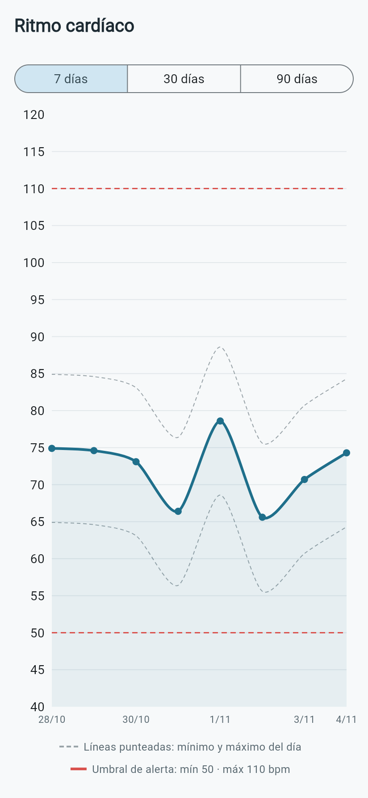](capturas/04-detalle-ritmo-cardiaco.png) |
| 5 | Medicamentos: adherencia de 7 días y dosis del día | [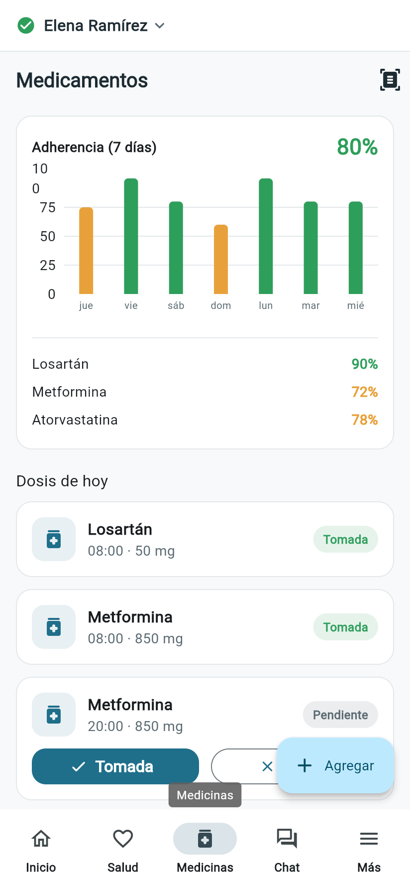](capturas/05-medicinas.png) |
| 6 | Centro de alertas por severidad (crítica, advertencia, informativa) | [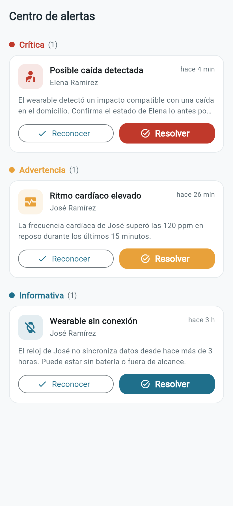](capturas/06-centro-alertas.png) |
| 7 | Configuración de umbrales con sliders, incluida presión arterial | [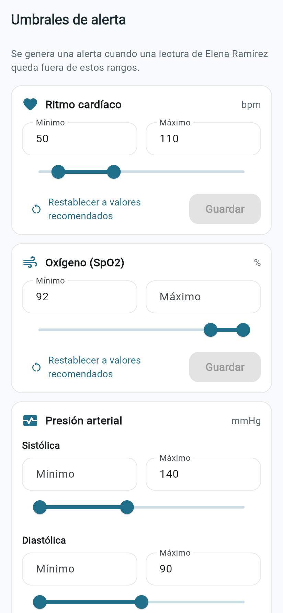](capturas/07-umbrales.png) |
| 8 | Comunicación: chat del equipo de cuidado y asistente IA | [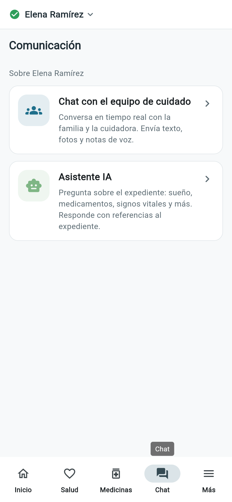](capturas/08-chat.png) |
| 9 | Círculo de cuidado: integrantes, roles e invitaciones | [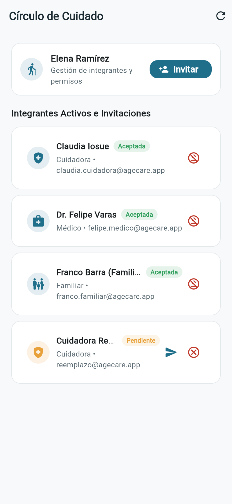](capturas/09-circulo-cuidado.png) |
| 10 | Alta del paciente | [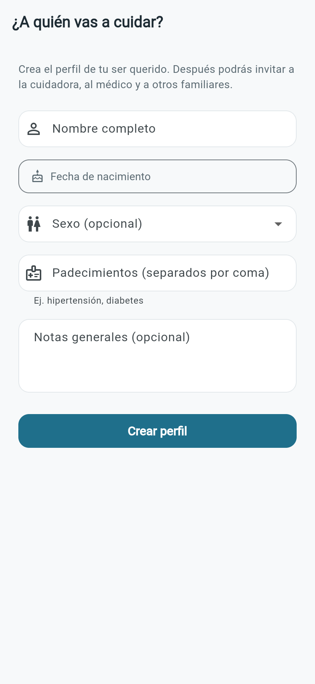](capturas/10-crear-paciente.png) |
| 11 | Expediente: recetas, estudios e identificaciones | [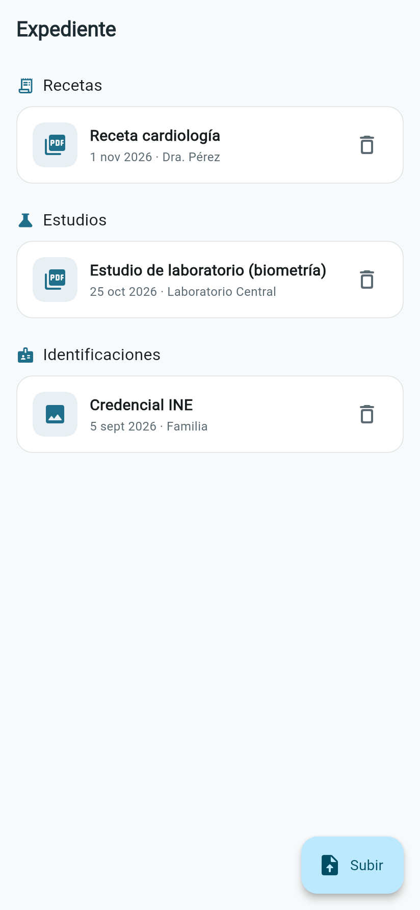](capturas/11-documentos.png) |
